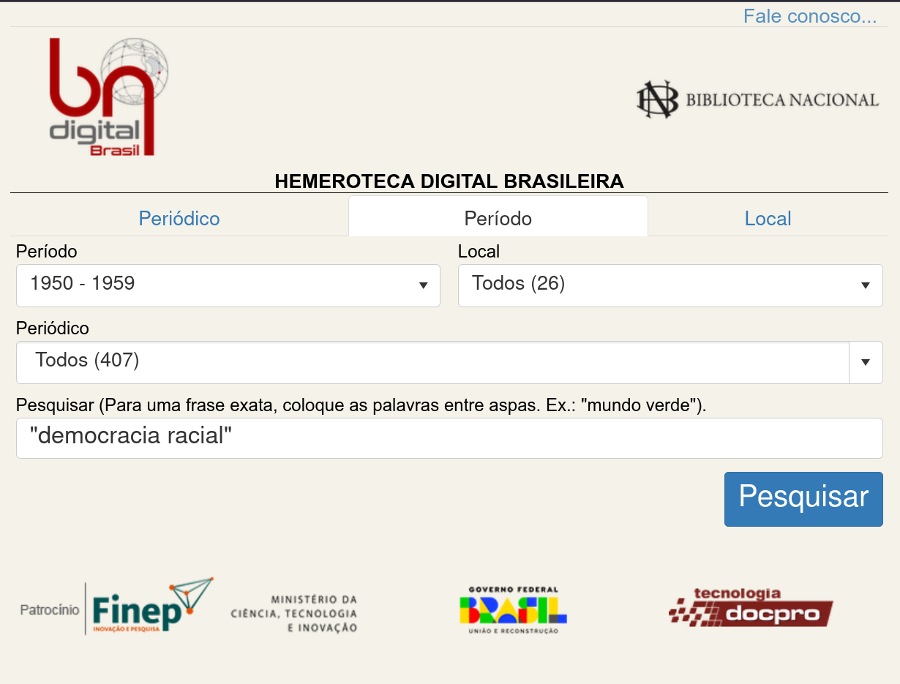
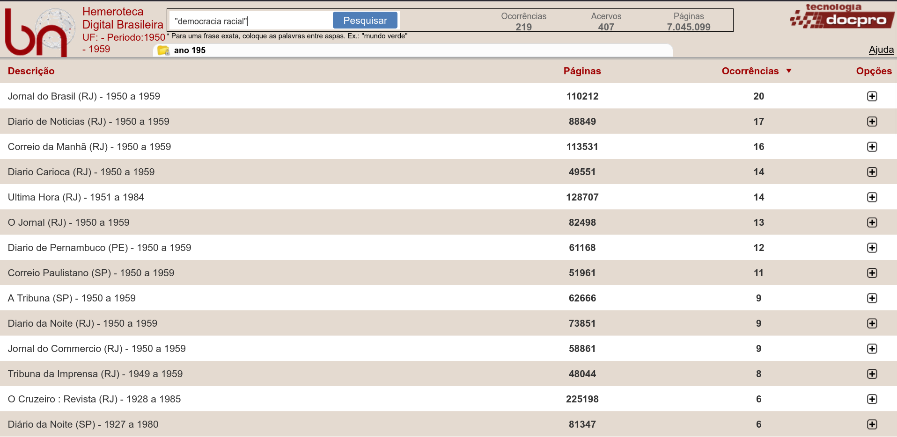
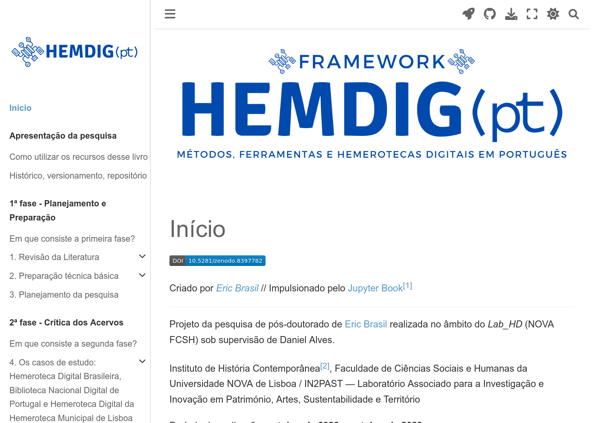
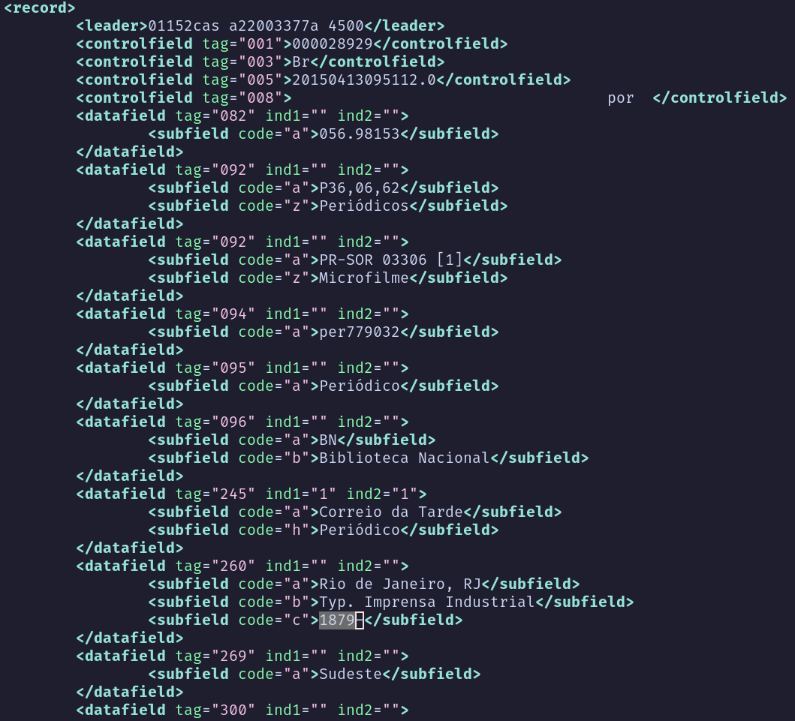
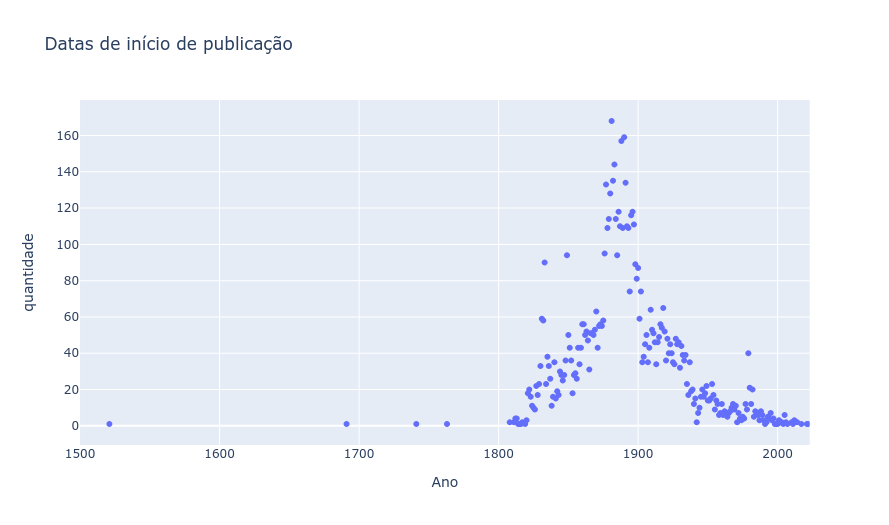
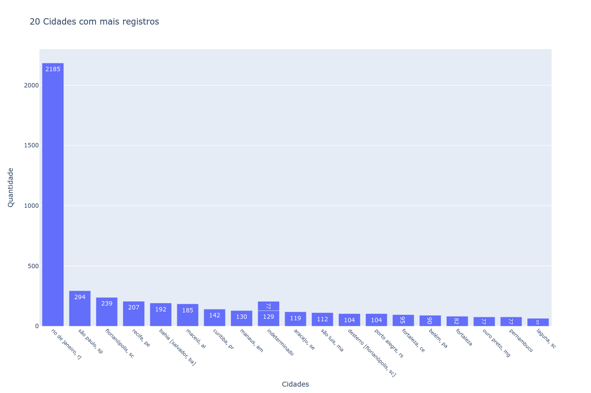

## Acesse a apresentação {.center}

[ericbrasil.com.br/imp-hist](https://ericbrasil.com.br/imp-hist/)

---

## O ponto de partida {.center}

::: {.fragment .fade-in}
**Em outubro de 2025, a Hemeroteca Digital Brasileira passou a exigir CAPTCHA para o acesso automatizado.**
:::

::: {.notes}
A aula começa com uma mudança aparentemente técnica. Ela altera as condições concretas de pesquisa. Não vou tratar o CAPTCHA apenas como um obstáculo operacional. A pergunta é o que ele revela sobre dependência, infraestrutura e método.
:::

---

## Um CAPTCHA pode ser uma decisão historiográfica

- Acesso humano e acesso automatizado deixam de ser equivalentes.
- Uma coleção pública continua visível, mas torna-se menos pesquisável em escala.
- A interface passa a definir quem pode perguntar, como pode perguntar e com que volume.

::: {.notes}
O ponto não é dizer que toda restrição técnica produz automaticamente uma consequência historiográfica. O ponto é reconhecer que a infraestrutura organiza as possibilidades da pesquisa.
:::

---

## O comunicado oficial de 3 de outubro de 2025

> “Atenção: comunicado importante para os usuários da Hemeroteca Digital Brasileira”

**Fonte:** Fundação Biblioteca Nacional, 03/10/2025.

[Comunicado oficial](https://www.gov.br/bn/pt-br/central-de-conteudos/noticias/atencao-comunicado-importante-para-os-usuarios-da-hemeroteca-digital-brasileira)

::: {.notes}
A data do comunicado não prova, sozinha, quando todos os efeitos técnicos começaram. Nesta apresentação, o foco é a decisão documentada e suas consequências metodológicas.
:::

---

## Breve apresentação

**Eric Brasil**

- Professor Adjunto da UNILAB.
- Professor permanente do PPGIHD/UFRRJ.
- Pesquisador do LABHDUFBA.
- Editor-chefe do *Programming Historian em Português*.

**Pesquisas:** História Digital · pós-abolição · imprensa · hemerotecas · IA e agentes.

::: {.notes}
Minha trajetória combina História Social, História Digital e pesquisa com fontes digitalizadas. O problema das hemerotecas não é externo ao meu trabalho. Ele atravessa projetos, ferramentas e decisões metodológicas que venho desenvolvendo com colaboradores e estudantes.
:::

---

## O que pesquiso quando pesquiso na HDB?

A pergunta que organiza a apresentação:

> **Pesquisamos jornais ou pesquisamos também a infraestrutura que os torna legíveis?**

::: {.notes}
A partir deste ponto, incorporo a estrutura da apresentação anterior sobre a Hemeroteca Digital Brasileira. O objetivo não é repetir um roteiro antigo, mas usar aquele percurso como base para discutir o que mudou depois do CAPTCHA e diante da IA generativa.
:::

---

## Desconhecimento técnico é um problema metodológico. {.center}

::: {.center}
**Desconhecer a técnica também é desconhecer parte da fonte.**
:::

---

## Rigor metodológico {.center}

> “Os métodos de pesquisa digital criam demandas novas e às vezes mais rigorosas de precisão, pensamento metodológico, auto-organização e colaboração do que a pesquisa histórica tradicional.”

**Fridlund; Oiva; Paju, 2020. Tradução minha.**

---

## Hermenêutica da prática {.center}

> Uma teoria das práticas que permite refletir criticamente sobre os desafios teóricos e artesanais do trabalho digital e conceber soluções práticas para enfrentá-los.

**Lucchesi, 2020. Tradução minha.**

---

## Ferramentas digitais condicionam nossas perguntas?

- Cada ferramenta reúne decisões políticas que podem escapar ao pesquisador.
- A *black box* metodológica dificulta avaliar, reproduzir e criticar resultados.
- Ferramentas e métodos digitais produzem efeitos epistemológicos.

---

## E a inteligência artificial nesse processo? {.center}

::: {.center}
**A IA generativa chegou. A crítica da fonte continua necessária.**
:::

---

## O que pesquisamos quando pesquisamos na HDB? {.center}

---

## A interface também é um argumento {.center}

::: {.notes}
A interface não é uma janela transparente para os dados. Ela organiza busca, ordenação, visualização, recorte e comparação.
:::

---

## Como compreender os dados da HDB?

- É possível compreender o acervo através da interface?
- As escolhas técnicas afetam a compreensão dos dados?
- O que aparece nos resultados?
- O que fica fora do índice?

---

## Acessando os dados

- API?
- *Web scraping* ou coleta manual?
- Dados abertos?
- Metadados estruturados?
- OCR e imagens de página?

---

## Pesquisa de pós-doutorado

- Desenvolvimento de um *framework* para pesquisas com periódicos em língua portuguesa digitalizados.
- Casos de estudo: HDB e Biblioteca Nacional Digital de Portugal.
- Resultado: [HEMDIG(pt)](https://ericbrasil.com.br/hemdig-framework/).

---

## HEMDIG(pt) {.center}

---

## Uma visão geral dos dados: MARCXML

- título do periódico;
- subtítulo;
- local de publicação;
- editora;
- período de publicação;
- periodicidade;
- idioma.

---

## O catálogo também produz um recorte {.center}

| Campo | Quantidade |
|---|---:|
| Título | 7.685 |
| Subtítulo | 3.666 |
| Local | 7.608 |
| Período | 7.265 |
| Editora | 5.675 |
| Periodicidade | 5.901 |
| Idioma | 6.614 |

---

## Recorte do arquivo XML {.center}

---

## Escopo cronológico e espacial

- 673 locais únicos.
- 7.685 títulos.
- Publicações entre 1521 e 2022.

---

## Viés cronológico? {.center}

---

## Viés espacial? {.center}

---

## O que muda com a inteligência artificial?

- A busca deixa de ser apenas correspondência de palavras.
- Modelos podem classificar, resumir, relacionar e sugerir.
- A escala de exploração aumenta.
- A opacidade também pode aumentar.

::: {.notes}
A IA não elimina a crítica da fonte. Ela desloca a crítica para novas camadas: dados de treinamento, modelo, prompt, contexto, ferramenta, índice e rastreabilidade da resposta.
:::

---

## O que muda com agentes de IA?

Um agente pode combinar:

1. uma pergunta histórica;
2. uma busca em fontes ou APIs;
3. recuperação de documentos;
4. ferramentas de análise;
5. síntese de resultados;
6. registro ou encaminhamento da pesquisa.

::: {.notes}
O agente não é apenas um chatbot. Ele pode executar etapas, usar ferramentas e encadear operações. Por isso, precisamos distinguir autonomia operacional de autonomia epistemológica. O agente pode agir sem poder decidir sozinho o que constitui uma boa evidência histórica.
:::

---

## Quem acessa?

A abertura de uma interface não garante abertura da pesquisa.

- Quem tem acesso à interface?
- Quem tem acesso à API?
- Quem pode fazer muitas requisições?
- Quem pode hospedar modelos?
- Quem pode auditar os resultados?
- Quem fica dependente de plataformas privadas?

---

## Interface, API e agente

::: {.columns}
::: {.column width="30%"}
**Interface**

explorar

visualizar

comparar
:::

::: {.column width="30%"}
**API**

consultar

coletar

reprocessar
:::

::: {.column width="30%"}
**Agente**

encadear

interpretar

registrar
:::
:::

::: {.notes}
Essas camadas não são equivalentes. Cada uma oferece capacidades diferentes e produz uma relação diferente com a fonte.
:::

---

## O agente não é um historiador

- Pode executar operações.
- Pode combinar fontes e ferramentas.
- Pode produzir hipóteses.
- Não substitui crítica de procedência, contexto e evidência.
- Precisa deixar rastros para ser auditado.

---

## E agora?

- interdisciplinaridade;
- colaboração;
- transparência e ciência aberta;
- dados e APIs abertas;
- formação técnica;
- documentação e versionamento;
- financiamento e políticas públicas.

---

## Tese de trabalho

> **A hemeroteca digital não é apenas um repositório de fontes. É uma infraestrutura que participa da produção do conhecimento histórico.**

Com IA e agentes, essa infraestrutura passa a incluir também:

- modelos;
- APIs;
- índices semânticos;
- ferramentas;
- registros de execução.

---

## Contatos pessoais {.center}

- Email: [profericbrasil@unilab.edu.br](mailto:profericbrasil@unilab.edu.br)
- [Orcid](https://orcid.org/0000-0001-5067-8475) · [Lattes](http://lattes.cnpq.br/6853705640900524)
- [Site pessoal](https://ericbrasil.com.br)

---

## Fontes e referências

- Fundação Biblioteca Nacional. “Atenção: comunicado importante para os usuários da Hemeroteca Digital Brasileira”. 03 out. 2025.
- Brasil, Eric. “Interfaces de hemerotecas digitais em português”. *Matraga*, v. 32, n. 65, 2025. DOI: [10.12957/matraga.2025.89783](https://doi.org/10.12957/matraga.2025.89783).
- Impresso. [Objectives](https://impresso.github.io/project/objectives/).
- Impresso. [Public API Documentation](https://dev.impresso-project.ch/public-api/v1/docs/).
- Repositório de referência: [slacsc](https://github.com/ericbrasiln/slacsc).

---

## Muito obrigado! {.center}
